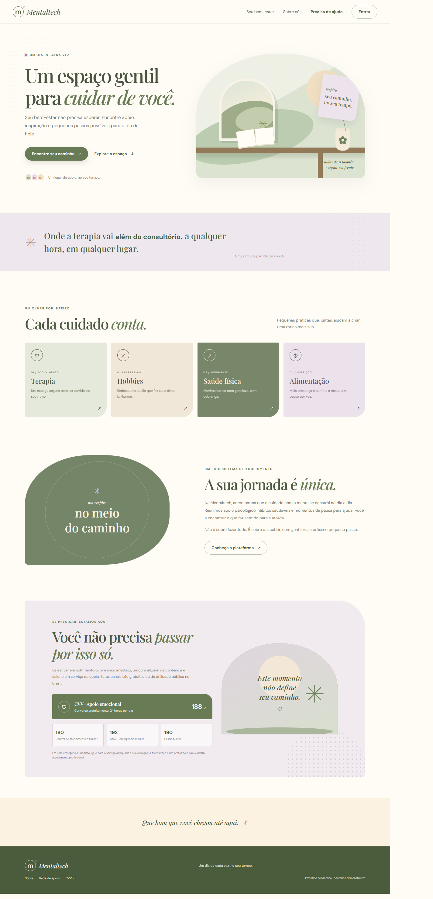
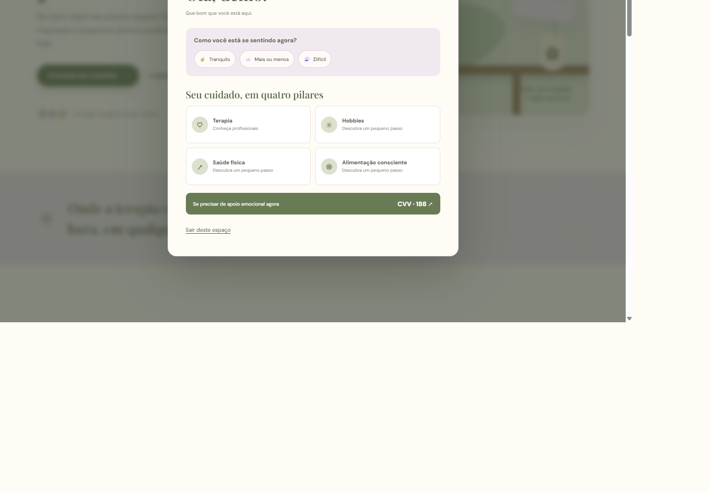
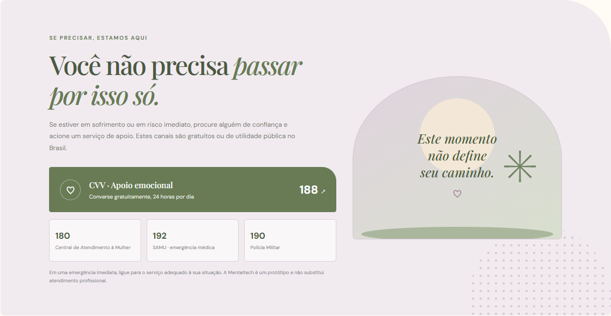

# Mentaltech

Protótipo navegável para uma plataforma de autocuidado e acolhimento emocional, inspirado na documentação oficial do Board Mentaltech e em seu mood board visual.

> **Importante:** este projeto é uma demonstração acadêmica. Não oferece atendimento médico ou psicológico, não realiza agendamentos e não substitui ajuda profissional. Perfis e informações de exemplo não representam serviços reais.

## O projeto

A Mentaltech apresenta um espaço acolhedor onde o cuidado com a mente vai além de consultas no consultório. A experiência organiza o bem-estar em quatro pilares — **terapia, hobbies, saúde física e alimentação consciente** — e deixa canais de apoio de emergência sempre acessíveis.

O protótipo inclui:

- página inicial responsiva, com navegação entre seções;
- acesso demonstrativo por e-mail ou CPF e senha, ou exploração como visitante;
- área pessoal demonstrativa com check-in de humor, guardado no navegador;
- quatro pilares interativos e listagem de profissionais fictícios;
- seção de apoio rápido com links `tel:` para CVV (188), Central de Atendimento à Mulher (180), SAMU (192) e Polícia Militar (190);
- layouts acessíveis para computador e celular.

## Telas

### Início



### Área pessoal



### Apoio e emergência



## Como executar

Não é necessário instalar dependências.

1. Abra `index.html` no navegador; ou
2. Na pasta do projeto, inicie um servidor estático local:

   ```powershell
   py -m http.server 8000
   ```

3. Abra `http://localhost:8000`.

Para entrar na demonstração, informe qualquer e-mail (ou CPF) e uma senha com pelo menos quatro caracteres. Você também pode escolher **Conhecer sem entrar**. Os dados de demonstração permanecem somente no armazenamento local do seu navegador; não há contas, serviços ou dados de saúde reais.

## Tecnologias

- HTML5 semântico
- CSS3 responsivo
- JavaScript nativo (ES2022)
- `localStorage` para guardar preferências de demonstração no dispositivo

Fontes: DM Sans e Playfair Display, carregadas do Google Fonts quando há conexão; o navegador usa fontes de sistema como alternativa.

## Estrutura

```text
mentaltech/
├── index.html
├── styles.css
├── app.js
├── screenshots/
└── README.md
```

## Canais de apoio no Brasil

- **188 — CVV:** apoio emocional gratuito, disponível 24 horas. [cvv.org.br](https://www.cvv.org.br/)
- **180 — Central de Atendimento à Mulher**
- **192 — SAMU**
- **190 — Polícia Militar**

Em uma emergência imediata, procure uma pessoa de confiança e ligue para o serviço adequado à situação. Os números acima seguem a documentação fornecida para o protótipo.
